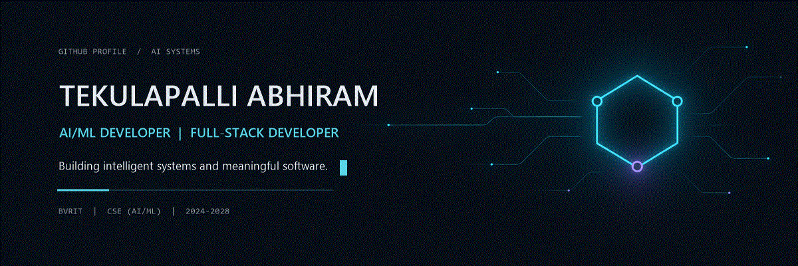

  <picture>
    <source media="(prefers-reduced-motion: reduce)" srcset="assets/header-static.png" />
    
  </picture>

  
  
  

  <samp><b>AI/ML DEVELOPER&nbsp; · &nbsp;FULL-STACK DEVELOPER</b></samp> 
  Building intelligent systems and meaningful software. 
  B.Tech, Computer Science &amp; Engineering (AI/ML) · BVRIT · 2024–2028

---

### 01 / Focus

I like turning research and real-world problems into software people can actually use. Lately, that means applied machine learning, agentic systems, and thoughtful full-stack products.

### 02 / Toolkit

  LANGUAGES &amp; DATA 
  

  PRODUCT &amp; ENGINEERING 
  

  MACHINE LEARNING 
  

### 03 / Selected work

**[BoreWell Sentinel India](https://github.com/abhiram-tekulapalli/BoreWell-Sentinel-India)** · [Live demo](https://borewell-sentinel-india-rho.vercel.app/) 
Groundwater quality intelligence: explore contaminant risk, testing priorities, trends, and water-quality signals on an interactive map. 
PYTHON &nbsp;·&nbsp; MACHINE LEARNING &nbsp;·&nbsp; GEOSPATIAL DATA

**[Online Shopper Intent Radar](https://github.com/abhiram-tekulapalli/Online-Shopper-Intent-Radar)** 
An end-to-end machine-learning project that estimates purchase intent from browsing sessions, compares models, and presents predictions in a Streamlit app. 
PYTHON &nbsp;·&nbsp; PANDAS &nbsp;·&nbsp; SCIKIT-LEARN &nbsp;·&nbsp; STREAMLIT

**[InboxPilot AI](https://github.com/abhiram-tekulapalli/InboxPilot-AI)** 
A serverless email-intelligence agent that classifies and prioritizes messages, then brings the digest into a Google Sheets and Telegram workflow. 
GOOGLE APPS SCRIPT &nbsp;·&nbsp; GEMINI &nbsp;·&nbsp; GMAIL &nbsp;·&nbsp; GOOGLE SHEETS

<a href="https://github.com/abhiram-tekulapalli?tab=repositories">Explore the rest of my repositories ↗</a>

### 04 / GitHub activity

  
  &nbsp;&nbsp;
  

  <picture>
    <source media="(prefers-color-scheme: dark)" srcset="https://raw.githubusercontent.com/abhiram-tekulapalli/abhiram-tekulapalli/output/github-snake-dark.svg" />
    <source media="(prefers-color-scheme: light)" srcset="https://raw.githubusercontent.com/abhiram-tekulapalli/abhiram-tekulapalli/output/github-snake.svg" />
    
  </picture>

THANKS FOR STOPPING BY

