  

  
  
  
  

<b>AI / MACHINE LEARNING · FULL-STACK · DEVELOPER TOOLS</b> 
Computer Science & Engineering (AI/ML) · BVRIT · 2024–2028

---

  

### Toolkit

  

   
   
  

  
  
  
  
  
  
  
  
  
  
  

---

### Projects

| Project | What it does | Stack |
| --- | --- | --- |
| [**Research Atlas**](https://github.com/abhiram-tekulapalli/agentic-rag-research-platform) | Local research workspace that combines uploaded documents and web sources into cited, inspectable reports. | Python · RAG · FastAPI |
| [**BoreWell Sentinel India**](https://github.com/abhiram-tekulapalli/BoreWell-Sentinel-India) · [Live demo](https://borewell-sentinel-india-rho.vercel.app/) | Maps groundwater quality and turns CGWB measurements into contaminant predictions and testing priorities. | Python · ML · React · Leaflet |
| [**Online Shopper Intent Radar**](https://github.com/pokephantom98765/Online-Shopper-Intent-Radar) | Predicts purchase intent from browsing sessions and presents the machine-learning workflow in an interactive app. | Python · Pandas · scikit-learn · Streamlit |
| [**Platform-Based Ad Recommendation**](https://github.com/abhiram-tekulapalli/advertisment-platform-recommendation-system) | Recommends an advertising platform from business, audience, geography, and budget features. | Python · Pandas · NumPy · scikit-learn |
| [**Mini ML Projects**](https://github.com/abhiram-tekulapalli/Mini-ML-Projects) | Four notebook studies: diabetes prediction, loan approval, sonar rock-vs-mine classification, and spam detection. | Python · Jupyter · scikit-learn |
| [**InboxPilot AI**](https://github.com/abhiram-tekulapalli/InboxPilot-AI) | Serverless email assistant that organizes inbox signals into a Google Sheets and Telegram digest. | Apps Script · Gemini · Gmail · Sheets |
| [**SignalDesk**](https://github.com/abhiram-tekulapalli/SignalDesk) | Gathers newsletter updates, summarizes and ranks them, then sends a scheduled private briefing. | Apps Script · Gemini · Gmail · Telegram |
| [**LaTeX Resume Builder & AI Job Analyzer**](https://github.com/abhiram-tekulapalli/latex-resume-reviewer) | Creates and compiles LaTeX resumes with AI-assisted job matching and keyword analysis. | React · TypeScript · Tectonic · Cloudflare |
| [**Tex**](https://github.com/abhiram-tekulapalli/tex2pdf) | Chrome extension that compiles LaTeX to PDF locally in the browser with a WebAssembly engine. | TypeScript · React · Vite · WASM |
| [**Aura New Tab Dashboard**](https://github.com/abhiram-tekulapalli/chrome-dashboard) | Chrome new-tab workspace with clock, shortcuts, notes, todos, Pomodoro timer, and themes. | JavaScript · Chrome MV3 · CSS |
| [**StudyTravel Simulator**](https://github.com/abhiram-tekulapalli/study-travel-timer) | Gamified focus timer that turns study sessions into flight journeys with progress and session analytics. | React · Vite · Firebase · Gemini |
| [**Portfolio & CMS**](https://github.com/abhiram-tekulapalli/portfolio) | Personal site with a CMS, blog, and live GitHub and LeetCode statistics. | React · TypeScript · Tailwind · Express · MongoDB |

---

### GitHub Activity

  

  
  &nbsp;&nbsp;
  

  <picture>
    <source media="(prefers-color-scheme: dark)" srcset="https://raw.githubusercontent.com/abhiram-tekulapalli/abhiram-tekulapalli/output/github-snake-dark.svg" />
    <source media="(prefers-color-scheme: light)" srcset="https://raw.githubusercontent.com/abhiram-tekulapalli/abhiram-tekulapalli/output/github-snake.svg" />
    
  </picture>

Build with curiosity. Ship with care.

